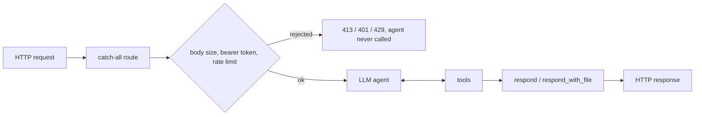

# dopamine

**An HTTP server with no routes. An LLM reads every request and decides what to answer.**

[](https://github.com/joojdev/dopamine/actions/workflows/ci.yml)

[](LICENSE)

<!-- TODO: demo GIF (record a terminal session of the curl calls below) -->

```bash
curl -i http://localhost:8000/api/products?color=purple \
     -H "Authorization: Bearer $TOKEN"
```

<!-- TODO: paste the real response of the command above, started with PERSONALITY=shop -->

## What is this?

A FastAPI app with exactly one real route: a catch-all. Every method on every path goes to
an LLM agent, which reads the method, path, query, headers and body, picks a status code,
and writes the response itself. It has a key-value store to remember things between
requests, so a `POST` can be followed by a `GET` that finds what was posted, most of the time.

## How it works



Before the agent runs, the request goes through the body-size limit, bearer-token check and
per-client rate limit, in that order. `Authorization` and `X-API-Key` are removed from what the
agent sees; other sensitive headers are replaced with `[REDACTED]`. The agent loops over its
tools until it calls one of the two respond tools (or runs out of steps or time).

Tools the agent can use (all available to both roles today):

| Tool | What it does |
|------|--------------|
| `respond` | Sends the final response: body, status code, headers, content type |
| `respond_with_file` | Sends a file from the `files/` sandbox |
| `list_files` | Lists the `files/` sandbox as a tree |
| `stat_file` | Path, line count and size of a file in `files/` |
| `read_file` | Reads a slice of a file in `files/` |
| `kv_set` / `kv_get` / `kv_list` / `kv_delete` | Key-value storage shared across requests |

Tools can be restricted to admin callers by declaring `role: str = "admin"` on the tool class
and adding it to `build_tools()` in `src/agent/registry.py`. Requests made with an admin token
get every tool; requests made with a user token get only user tools.

Every response produced by the agent carries `X-Dopamine-Tokens-In`, `X-Dopamine-Tokens-Out`
and `X-Dopamine-Steps`, plus `X-Dopamine-Cost-USD` when prices are configured. If the agent
answered without calling a respond tool, `X-Dopamine-Warning` says so.

## Quickstart

```bash
uv sync                                  # add --extra openai or --extra bedrock for those providers
cp .env.example .env                     # set LLM_MODEL, LLM_API_KEY and LLM_PROVIDER
uv run uvicorn src.api.app:app
```

The catch-all requires a token. To get one:

```bash
uv run tokens hash-password              # put the output in .env as ADMIN_PASSWORD_HASH,
                                         # and set ADMIN_USERNAME, then restart the server
curl -s -X POST localhost:8000/_admin/login -H 'content-type: application/json' \
     -d '{"username": "admin", "password": "<your password>"}'     # -> {"token": "adm_…", …}
curl -s -X POST localhost:8000/_admin/tokens -H "Authorization: Bearer $ADMIN_TOKEN" \
     -H 'content-type: application/json' -d '{"name": "laptop"}'   # -> {"token": "sk_…", …}
```

Or skip the server entirely: `uv run tokens create laptop`. Tokens are listed with
`uv run tokens list` (or `GET /_admin/tokens`) and revoked with `uv run tokens revoke <id>`
(or `DELETE /_admin/tokens/<id>`). The full token is shown once; only its SHA-256 hash is
stored. For local experiments, `AUTH_ENABLED=false` lets requests through without a token.

## Configuration

All settings come from environment variables or `.env`.

| Variable | Default | Description |
|----------|---------|-------------|
| `LLM_PROVIDER` | `anthropic` | `anthropic`, `openai` or `bedrock` |
| `LLM_MODEL` | *(required)* | Model identifier for the provider |
| `LLM_API_KEY` | *(empty)* | Required for `anthropic` and `openai` |
| `AWS_PROFILE` | *(empty)* | Bedrock only: AWS profile to use |
| `AWS_REGION` | *(empty)* | Bedrock only: AWS region |
| `HOST` | `0.0.0.0` | Declared but not read by `uvicorn src.api.app:app`; pass `--host` to uvicorn |
| `PORT` | `8000` | Declared but not read by `uvicorn src.api.app:app`; pass `--port` to uvicorn |
| `MAX_REQUEST_BODY_SIZE` | `1048576` | Bytes; larger bodies get 413 before the agent runs |
| `PERSONALITY` | `default` | Preset name from `config/personalities/` |
| `PERSONALITY_PATH` | *(empty)* | Custom personality file; wins over `PERSONALITY` |
| `AGENT_VERBOSE` | `false` | Log every agent step |
| `RATE_LIMIT_PER_MINUTE` | `20` | Per-client requests per minute on the catch-all (429 beyond) |
| `AGENT_TIMEOUT_SECONDS` | `30` | Seconds before the agent is abandoned (504) |
| `SENSITIVE_HEADER_NAMES` | `authorization,proxy-authorization,cookie,set-cookie,x-api-key` | Header values replaced with `[REDACTED]` for the agent |
| `SENSITIVE_HEADER_FRAGMENTS` | `token,secret,key` | Any header whose name contains one of these is redacted too |
| `STATE_FILE` | *(empty)* | JSON file for the key-value store; empty = in memory |
| `KV_MAX_VALUE_BYTES` | `65536` | Max size of one stored value |
| `KV_MAX_KEYS` | `1000` | Max number of stored keys |
| `LLM_PRICE_INPUT_PER_MTOK` | *(unset)* | USD per million input tokens; set both prices to get `X-Dopamine-Cost-USD` |
| `LLM_PRICE_OUTPUT_PER_MTOK` | *(unset)* | USD per million output tokens |
| `ADMIN_USERNAME` | *(empty)* | Admin login name; `/_admin/` answers 404 while unset |
| `ADMIN_PASSWORD_HASH` | *(empty)* | argon2 hash from `uv run tokens hash-password`, never the plain password |
| `ADMIN_TOKEN_TTL_MINUTES` | `60` | Lifetime of admin tokens issued by login |
| `LOGIN_RATE_LIMIT_PER_MINUTE` | `5` | Per-client login attempts per minute |
| `TOKENS_DB_PATH` | `data/tokens.db` | SQLite file with token hashes (`data/` is git-ignored) |
| `AUTH_ENABLED` | `true` | `false` lets token-less requests through as a user; local development only |

## Personalities

The personality is the system prompt's opening act. Pick one with `PERSONALITY=<name>`:

- `default`: a helpful assistant. The control group.
- `shop`: the backend of Acme Absurdities, selling bottled Tuesday air and left-handed spoons.
- `sarcastic`: a deeply tired API. The JSON is correct; the sighing is extra.
- `website`: an imaginary website that picks its theme from the first path it sees, then
  serves full HTML pages for it.
- `teapot`: answers 418 to everything, as RFC 2324 intended.

To add one, drop a Markdown file in `config/personalities/` and use its file name (without
`.md`) as `PERSONALITY`, or point `PERSONALITY_PATH` at a file anywhere.

<!-- TODO: paste one real response per preset, e.g. `curl -s localhost:8000/ -H "Authorization: Bearer $TOKEN"` -->

## Why you should never use this in production

| Risk | What it means here | Mitigation in this project |
|------|--------------------|----------------------------|
| Latency | Every request is at least one LLM round trip, usually several tool steps | `AGENT_TIMEOUT_SECONDS` returns 504 instead of waiting forever. Nothing makes it fast |
| Cost per request | Every request spends tokens, including ones from strangers | Bearer tokens (admin login + user tokens), per-client rate limit, body-size limit, usage and cost headers on every response |
| Non-determinism | The same `GET` can answer differently twice | None. The key-value store and prompt instructions make it more consistent, not consistent |
| Prompt injection via the body | The request body is model input; a body can ask the agent to misbehave | Partial: admin-only tools are never offered to user-token requests, and the file tools are confined to `files/`. Nothing stops the model from following instructions in the body |
| Request data sent to a third party | Paths, query strings, headers and bodies go to your LLM provider | `Authorization` and `X-API-Key` are removed; other sensitive headers are replaced with `[REDACTED]`. Everything else is sent |
| Hallucinated status codes | The model picks the status code, and may pick a creative one | None. The prompt asks for semantic codes; the model decides |

## How it was built

With spec-driven development using [Spec Kit](https://github.com/github/spec-kit): each feature
started as a specification, then a plan, then a task list, then code written test-first. All of
it is in [`specs/`](specs/), including the arguments the project had with itself.

## Contributing

Issues and pull requests are welcome. Before opening a PR:

```bash
uv sync --extra dev
uv run ruff check . && uv run ruff format --check .
uv run pytest
```

CI runs the same checks on Python 3.11 and 3.12. Tests use fake LLMs; no API key is needed.

## License

[MIT](LICENSE) © 2026 João Vitor Piovezan
