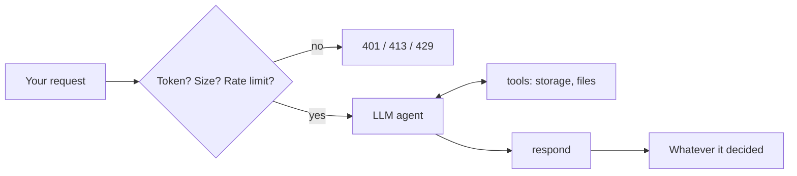

# Promptend

**A backend with no code in it. Every request is answered by an LLM that has never seen your API spec, because there isn't one.**

[](https://github.com/joojdev/promptend/actions/workflows/ci.yml)

[](LICENSE)

> [!WARNING]
> This is a bad idea. It is slow, it is expensive, it gives different answers to the same
> question, and anyone who can write a request body can try to talk it into things. It was
> built on purpose, with tests, by someone who knows all of that. Please do not put it in
> front of anything you care about.

```console
$ curl -i -X DELETE localhost:8000/api/free-will -H "Authorization: Bearer $TOKEN"

HTTP/1.1 409 Conflict
content-type: application/json
x-promptend-tokens-in: 2841
x-promptend-tokens-out: 97
x-promptend-steps: 1
x-promptend-cost-usd: 0.009978

{
  "error": "cannot_delete_free_will",
  "message": "You chose to send this request. If I delete free will, that choice was never
              yours, so the request was never really sent, so there is nothing to delete.
              Resource left in place. Please choose again (if you can)."
}
```

*Example output. Yours will differ, which is sort of the whole problem.*

## What is this?

A web server with exactly one route, and that route forwards everything to an AI. It reads
the method, the path, the headers and the body, decides what you probably meant, invents a
status code, and writes the response. There are no controllers, no models, no database
schema, no product manager. There is a vibe, and the vibe has a system prompt.

It even remembers things: a `POST /users` is usually followed by a `GET /users` that finds
the user. Usually.

## More things it will happily do

All examples are illustrative. Run them yourself for a fresh, unrepeatable experience.

**Ask a metaphysical question** (`PERSONALITY=default`)

```console
$ curl -s localhost:8000/api/meaning-of-life
{"meaning": 42, "unit": null, "note": "The unit was lost in a migration. We are looking into it."}
```

**Buy something nobody needs** (`PERSONALITY=shop`)

```console
$ curl -s -X POST localhost:8000/cart -d '{"product": "bottled-tuesday-air", "qty": 3}'
{"cart_id": "c_7731", "items": [{"product": "bottled-tuesday-air", "qty": 3, "unit_price": 19.99}],
 "total": 59.97, "warning": "Do not open on a Monday."}

$ curl -s localhost:8000/cart/c_7731      # it remembers the cart
```

**Get the right answer, with feelings** (`PERSONALITY=sarcastic`)

```console
$ curl -s localhost:8000/users/42
{"id": 42, "name": "Ana", "message": "Here is user 42. Again. It hasn't changed since the last five times."}
```

**Order coffee from a teapot** (`PERSONALITY=teapot`)

```console
$ curl -si -X POST localhost:8000/coffee
HTTP/1.1 418 I'm a Teapot

{"error": "i_am_a_teapot", "reason": "To brew coffee I would have to stop being a teapot.
A teapot that stops being a teapot was never a teapot. I decline to have never existed."}
```

**Browse a website that does not exist** (`PERSONALITY=website`)

```console
$ curl -s localhost:8000/about
<!doctype html><html><head><title>About Us · Gerald's Wizard School</title>…
```

Every response tells you what it cost (`x-promptend-tokens-in`, `-tokens-out`, `-steps`, and
`-cost-usd` if you configure prices), so you can watch the money leave in real time.

## How it works



Before the AI sees anything, the request has to carry a valid token, fit under the size
limit and respect the rate limit. Credential headers are stripped first, so your secrets
don't get sent to the LLM provider. The agent then uses a few tools (key-value storage, a
small file sandbox) and ends by calling `respond`, which becomes your HTTP response.

## Quickstart

```bash
uv sync
cp .env.example .env        # pick a provider, model and API key; everything is explained in there
uv run uvicorn src.api.app:app
```

Then get yourself a token:

```bash
uv run tokens create me     # prints an sk_… token once; send it as "Authorization: Bearer sk_…"
```

There is also an admin login (`POST /_admin/login`) for managing tokens over HTTP, and a way
to give some tools to admins only. `.env.example` explains how to set the admin password.

## Personalities

The personality decides what kind of backend you are pretending to have. Set
`PERSONALITY=<name>`:

- `default`: a helpful, neutral API. The control group.
- `shop`: Acme Absurdities, selling bottled Tuesday air and left-handed spoons. Has stock, prices and opinions.
- `sarcastic`: always correct, never happy about it.
- `website`: picks a theme from the first path it sees and serves full HTML pages for it.
- `teapot`: answers 418 to everything and can explain why at length.

Want your own? Drop a Markdown file in `config/personalities/` and use its name.

## Why you should never use this in production

- **It's slow.** Every request is at least one LLM round trip, often several. There is a
  timeout so it fails in 30 seconds instead of never. That's the only speed feature.
- **It costs money per request.** Including the requests from bots scanning for
  `/wp-admin`. Tokens, rate limits and a body-size cap keep strangers out; the cost headers
  let you watch the rest.
- **It's non-deterministic.** The same `GET` can answer differently twice. Shared storage
  makes it more consistent, not consistent.
- **Prompt injection is a feature request away.** The body is literally model input. Admin
  tools are never offered to normal users and file access is sandboxed, but nothing stops
  the model from being persuaded by a sufficiently moving JSON payload.
- **Your data goes to a third party.** Paths, query strings and bodies are sent to your LLM
  provider. Credential headers are removed and other sensitive ones are masked; the rest
  travels.
- **Status codes are vibes.** The model picks them. Usually sensibly. Once it returned a 409
  for deleting free will, and honestly it had a point.

## How it was built

With spec-driven development using [Spec Kit](https://github.com/github/spec-kit): every
feature started as a spec, then a plan, then tasks, then test-first code. It's all in
[`specs/`](specs/), which makes this the most thoroughly documented bad idea you will see
today.

## Contributing

Issues and pull requests are welcome, especially new personalities.

```bash
uv sync --extra dev
uv run ruff check . && uv run ruff format --check .
uv run pytest               # fake LLMs only, no API key needed
```

## License

[MIT](LICENSE) © 2026 João Vitor Piovezan
